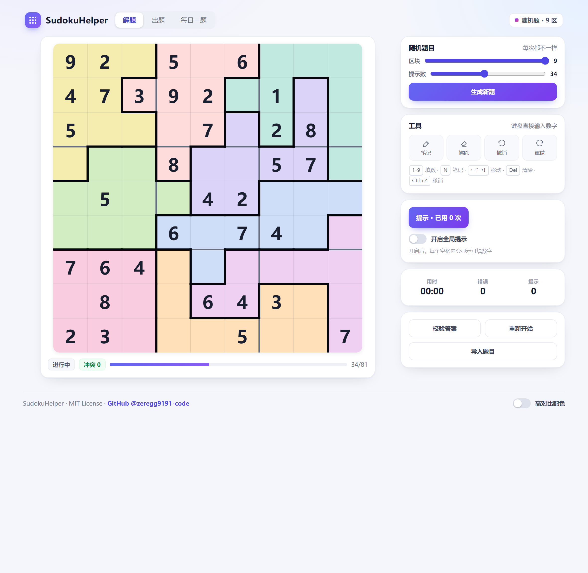

# SudokuHelper · 异形数独

单文件、零依赖的异形（Jigsaw）数独工具。双击 `sudoku.html` 即可在浏览器里运行，不需要服务器、不需要联网。

> 面向 PC 端：用键盘输入数字，不提供屏幕数字键盘。




## 一、核心规则

- 异形区域 **1～9 个**皆可，每个区域必须**正好 9 格**；
- 区域**不要求连通**（可以是被打散的 9 个格子）；
- 区域之间不能重叠；不必覆盖全部 81 格；
- 每个区域内的数字 1–9 不能重复（生成时自动保证）。

---

## 二、三个页面

### 1. 解题

| 功能 | 说明 |
|---|---|
| **随机题目** | 打开即随机生成一道题；右侧可调**区块数 1–9**和**提示数 20–50**，点「生成新题」换一道（自己的设置会记住） |
| 键盘输入 | `1-9` 填数、`N` 切笔记、方向键移动、`Del`/`Backspace` 清除、`Ctrl+Z` / `Ctrl+Shift+Z` 撤销重做 |
| 冲突高亮 | 行 / 列 / 3×3 宫 / 异形区域内重复的数字标红 |
| 同数高亮 | 选中一格后全盘相同数字加深底色 |
| **开启全局提示** | 开关打开后，每个空格内显示可填数字（默认关闭；每日一题里不提供） |
| **提示** | 点击后随机揭示一个空格的正确答案，并累计"已用 N 次" |
| 校验答案 | 检查行、列、宫、区域四条规则并指出冲突 |
| **导入题目** | 粘贴分享码（`SH1.…`）还原题目 |

### 2. 出题

四步：**画区域 → 填数字 → 挖空 → 分享**

- **画区域**：点选区域槽 `R1–R9`，用**画笔**勾选（再点一次取消）、**橡皮**擦除；实时显示每个区域 `x/9`。区域 1～9 个都行，不连通也允许。某个槽填满 9 格后会**自动跳到下一个空槽**。
- **数字**：切到数字工具后，点格子直接按 `1-9` 写入提示数，`Del` 删除。这些数字会被当作**必须保留**的提示数。
- **生成答案**：在"区域约束 + 预填数字"下求一个终盘；无解或超时会**弹窗**说明原因。
- **生成题目**：拖动"提示数"滑块后挖空，每挖一格都校验唯一解；预填的数字一定会保留。若凑不出唯一解会弹窗提示。
- **仅使用当前提示数**：勾选后，生成的题目必须**正好**是滑块上的提示数。做不到时会告诉你"当前条件下最少需要 N 个"，并可取消勾选退回普通模式。
- **不卡界面**：随机区域与挖空都是**分片执行**的（每片约 100 次融化 / 6 次挖空），带进度条，操作期间按钮自动禁用，不会再把页面冻住。
- **校验**：检查区域合法性、终盘完整性、题目唯一性。
- **试玩此题 / 复制分享码**：分享码是一段字符串（约 112 字符），别人在「导入题目」里粘贴即可。
- **离开会提醒**：出题页如果已经生成了题目，切到别的页签时会询问「要复制分享码吗？」——可选复制并离开 / 不复制 / 取消。

### 3. 每日一题

- 以日期（`YYYY-MM-DD`）为种子，**同一天全平台同一题**，可复现；
- 首次进入生成约 1–2 秒，之后缓存在 localStorage；
- 记录连续打卡天数与最近 7 天完成情况；
- 完成后弹出结算，按钮变成**分享成绩**，复制如下文案：

  > 我在SudokuHelper的每日一题中使用 0 次提示，用时 1：31 完成了解密！【网址】

  `APP_URL` 留空时自动取当前网页地址；想固定成别的链接就在 `sudoku.html` 顶部填上。

### 4. 界面

- **页脚**：`SudokuHelper · MIT License · GitHub @zeregg9191-code`，直达仓库作者主页；
- **高对比配色**：页脚右侧开关，只作用于棋盘——区域底色接近白、边框更粗更深；选中某个数字时，同数字的格子会**整格反白**（深底白字），一眼就能扫出来。页面主题本身不变；选择会记在本地，也可用 `?hc=1` / `?hc=0` 指定；
- 出题页与解题页共用同一个棋盘，切页签不会丢状态。

---

## 三、算法要点

1. **求解器**：位运算 + 最小剩余值（MRV）回溯，支持"区域缺省"的格子（只在行/列/宫上受约束）。
2. **随机区域（"先解后融"）**：先生成合法终盘 → 从 3×3 宫出发，反复把两个相邻区域的 18 格并集重新切成两个连通的 9 格横向块 → 形状逐渐"融化"成异形；全程不需要额外求解验证。
3. **挖空保唯一解**：每挖一格跑一次求解器（解计数到 2 即停），仍唯一才真正挖掉；预填数字永远不挖。
4. **分享码**：81 个区域编号（4 bit）+ 81 个数字（4 bit）= 81 字节 → base64url，前缀 `SH1.`。

---

## 四、测试

```bash
node tools/test_app.mjs     # 核心逻辑 38 项
node tools/test_chunks.mjs  # 分片生成 / 精确提示数 13 项
```

`test_app.mjs` 从 `sudoku.html` 抽出纯逻辑段运行 **38 项断言**：终盘合法性、区域规则（1 个/3 个/断开的 9 格都合法，8 格/10 格非法）、部分区域求解、预填数字约束、挖空保唯一解且保留预填、分享码往返、每日题确定性等。

`test_chunks.mjs` 验证增量接口与一次性结果**逐格一致**：分片融化 = 一次性融化、`makeDigger` 分步 = `digPuzzle`、`digExact` 不会低于目标提示数且必为唯一解。

---

## 五、已知限制

- 每日题首次生成 1–2 秒（已先弹提示，生成后缓存）。
- 「生成答案」这一步仍是同步求解（通常几十毫秒，极端区域划分最多等 3 秒）。
- 手画区域若本身不可解，会弹窗说明原因。
- 进度只存本机 localStorage，无账号系统。
- 未接入 AI（属规划中的 P1）。

---

## 六、文件

| 文件 | 说明 |
|---|---|
| `sudoku.html` | 主程序（单文件） |
| `ui/app-desktop.png` | 解题页 |
| `ui/app-create.png` | 出题页 |
| `ui/app-daily.png` | 每日一题 |
| `ui/overview.png` | 设计概览图 |
| `异形数独平台_成本与功能方案.md` | 成本与功能规划 |
| `tools/test_app.mjs` | 核心逻辑测试 |
