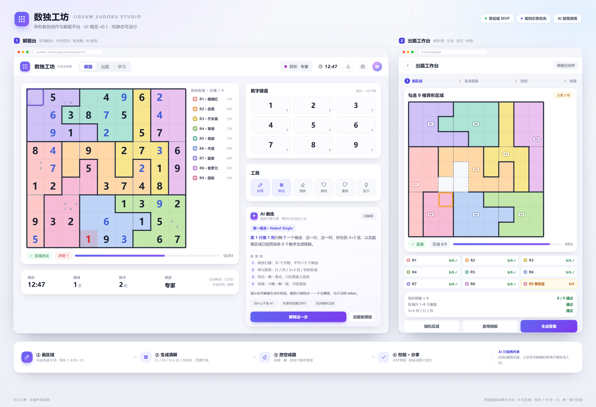

# 异形数独平台：成本估算与功能设计建议

> 版本 v0.1 · 2026-11-21 · 配套文件：`ui/overview.png`（UI 概览图）、`ui/solve.png`、`ui/editor.png`

---

## 0. 先给结论

| 问题 | 结论 |
|---|---|
| 需要服务器吗？ | **MVP 不需要**。你列的 1/2/3 三个功能全部可以在浏览器里算完，纯静态托管即可。 |
| 一年最低花多少钱？ | **¥0 – ¥90**（域名是唯一可选项）。 |
| 要国内正式运营呢？ | **¥700 – ¥1500/年**（服务器 + 域名 + 对象存储），不含 AI 调用。 |
| "内置 AI" 贵吗？ | **不贵**。单次讲解约 **¥0.002 – 0.005**；1000 日活 × 每天 5 次 ≈ **¥35 – 70/月**，做规则引擎兜底后还能再降一个数量级。 |
| 真正的成本在哪？ | **人力**（约 25 人日）和 **合规/备案**，不在算力。自建 GPU 推理完全不必。 |

一句话：**这是个"前端重、后端轻"的产品**，先把浏览器端做扎实，服务器和 AI 都可以后置。

---

## 1. 需求拆解：哪些必须联网

| 功能 | 计算位置 | 纯前端可行 | 说明 |
|---|---|---|---|
| ① 勾选 9 个连通异形区域 | 本地 | ✅ | 只是 UI + 连通性/格数校验，毫秒级 |
| ② 随机生成合法答案（行/列/宫/区四重约束） | 本地 | ✅ | 生成一次几百毫秒到几秒，放 Web Worker 即可 |
| ③ 合法性校验 | 本地 | ✅ | 微秒级，随便实时校验 |
| ④ 挖空出题 + 唯一解校验 | 本地 | ✅ | 每挖一格跑一次求解，几十毫秒 |
| ⑤ 分享题目 / 题库 / 排行榜 | 服务端 | ⭕ 可选 | 分享可先用 URL 编码绕过 |
| ⑥ AI 讲解 / 拍照识题 | 服务端代理 | ⭕ 可选 | 需要一个中转来藏 API Key、做限流 |

**所以：功能 1–3 是纯前端问题，不是服务器问题。** 你担心的"链接服务器"成本，在 MVP 阶段不存在。

---

## 2. 成本三档

### 档 A：纯前端（建议先做，1–2 周上线）

| 项目 | 方案 | 年成本 |
|---|---|---|
| 托管 | Cloudflare Pages / Vercel / GitHub Pages | ¥0 |
| 域名 | .com 约 ¥55–90/年；不买也行（用 `xxx.pages.dev`） | ¥0–90 |
| 数据库 | 无。进度存 IndexedDB，分享用 URL | ¥0 |
| HTTPS | 自动签发 | ¥0 |
| AI | 不接，或 BYOK（用户填自己的 Key，存本地） | ¥0 |
| **合计** | | **¥0 – 90/年** |

代价：国内访问速度看线路、没有跨设备同步、没有排行榜。
**这一档已经能完整交付你列的三个功能。**

### 档 B：轻后端（要分享/排行/AI 时加）

| 项目 | 方案 | 年成本 |
|---|---|---|
| 计算 | Cloudflare Workers：免费 **10 万请求/天**，超出 $5/月 | ¥0–430 |
| 存储 | D1 / KV 免费额度（够几万道题） | ¥0 |
| AI | 见第 3 节，按量 | 用量决定 |
| 域名 | 同档 A | ¥0–90 |
| **合计** | | **¥90 – 550/年 + AI** |

### 档 C：国内正式运营（小程序 / 需要国内速度）

| 项目 | 方案 | 年成本 |
|---|---|---|
| 云服务器 | 轻量 2C2G：活动价 ¥38–99/年，常规约 ¥45/月（≈¥540/年） | ¥99–900 |
| 域名 | ¥55–90/年 | ¥60 |
| ICP 备案 | 免费，7–20 个工作日 | ¥0 |
| 对象存储 + CDN | 1 万 PV/月量级，¥10–20/月 | ¥120–240 |
| SSL | 免费 | ¥0 |
| 微信认证（若做小程序） | ¥300/年 | ¥300 |
| **合计** | | **¥580 – 1500/年** |

> 价格取自 2026-11 公开报价（[阿里云轻量服务器](https://developer.aliyun.com/article/1736611)、[Cloudflare Workers 限额](https://developers.cloudflare.com/workers/platform/limits/)），以官网当期为准。

**建议路线：A → B → C。** 先用 A 验证玩法，有人用了再上 B，确有必要面向国内规模化再走 C。

---

## 3. AI 到底要花多少钱

### 3.1 计价基准（DeepSeek 官方定价页，2026-11 抓取）

| 模型 | 输入（缓存未命中） | 输出 | 缓存命中输入 |
|---|---|---|---|
| `deepseek-flash` 低谷 | $0.15 / 1M | $0.60 / 1M | $0.003 / 1M |
| `deepseek-flash` 高峰 | $0.30 / 1M | $1.20 / 1M | $0.006 / 1M |
| `deepseek-v4-pro` 高峰 | $1.32 / 1M | $3.96 / 1M | $0.044 / 1M |

另有 OCR：**$0.225 / 1000 页**；语音合成 TTS：**$0.45 / 万字符**；语音识别 ASR：**$0.116 / 小时**。
来源：[DeepSeek 定价文档](https://api-docs.deepseek.com/quick_start/pricing)。汇率按 1 USD ≈ ¥7.1 估算。

### 3.2 单次功能成本

| 场景 | Token 估算 | 单次成本 |
|---|---|---|
| 解释一步提示（文字） | 输入 1.2k / 输出 250 | **¥0.002 – 0.005** |
| 拍照/截图识题（OCR 接口） | 1 页 | **¥0.0016** |
| 出题点评 / 难度分析 | 输入 2k / 输出 600 | **¥0.006 – 0.012** |
| 语音讲解（TTS，300 字） | 300 字 | **≈ ¥0.10**（比文字贵 20 倍，慎用） |

### 3.3 规模化估算

假设每个用户每天用 5 次提示：

| 日活 | 月调用 | 全部走模型 | 规则引擎兜底 80% 后 |
|---|---|---|---|
| 100 | 1.5 万 | ¥35 – 70 / 月 | **¥7 – 14 / 月** |
| 1,000 | 15 万 | ¥350 – 700 / 月 | **¥70 – 140 / 月** |
| 10,000 | 150 万 | ¥3,500 – 7,000 / 月 | **¥700 – 1,400 / 月** |

折算下来约 **¥0.07 – 0.14 / 活跃用户 / 月**。对比：一台 2C2G 服务器 ≈ ¥45/月，等于 **300 个用户的 AI 费用**。

### 3.4 五个降本手段（按效果排序）

1. **规则引擎兜底**：候选数、唯一余数、隐性唯一、区块排除这些本地就能算，只有"要讲成人话"时才调模型 → 调用量直接降一个数量级。
2. **让模型只做转述，不做计算**：把求解器的推理步骤（structured steps）交给模型润色。既不会算错，也不需要长上下文。
3. **缓存系统提示词**：缓存命中价是未命中的 **1/50**，把技巧百科、输出格式放进去。
4. **免费额度限流**：免费用户每天 10 次，超出用积分/订阅，防止被刷。
5. **模型分级**：日常讲解用 `flash`，只有"整局复盘"这类才用 `pro`。

> 反直觉但重要：**AI 越"聪明"越不该直接解数独**。LLM 算数独会出错，而本地求解器 100% 正确且免费。AI 的定位是"教练"，不是"选手"。

---

## 4. 容易漏掉的隐性成本

| 项目 | 说明 | 影响 |
|---|---|---|
| **生成式 AI 备案** | 面向境内公众提供生成式 AI 服务，需按《生成式人工智能服务管理暂行办法》履行备案/安全评估 | 时间成本 1–2 个月，是最大不确定性 |
| **内容安全过滤** | 用户输入和模型输出都要过审，云厂商内容安全 API 约 ¥1/千次 | 每月几十元 |
| **ICP 备案主体** | 个人备案不得含经营性内容；小程序主体与类目也受限 | 可能卡住上线 |
| **微信小程序限制** | 请求域名必须已备案 + HTTPS，还要在小程序后台配 `request 合法域名`；主包 ≤2MB | AI 必须走自己服务器，且不能让用户直连第三方 API |
| **带宽** | 静态资源 1MB/次 × 1 万 PV ≈ 10GB/月，CF 免费；国内 CDN 约 ¥2/月 | 可忽略 |
| **维护** | 依赖升级、issue、备案年审，每月 1–2 小时 | 隐性人力 |
| **隐私合规** | 若做账号/云存档，需要隐私政策、数据删除入口 | 上线前必须补 |

**如果不想现在处理 AI 合规**：把 AI 做成"BYOK"（用户自己填 API Key，只存在浏览器本地），平台不碰用户请求内容，成本与责任都转移出去。缺点是新用户门槛高，可以后续再升级成平台代付。

---

## 5. 人力成本（真正的开销）

| 模块 | 人日 | 说明 |
|---|---|---|
| 棋盘渲染与交互（触屏/键盘/笔记/高亮） | 4 | 最容易被低估，细节很多 |
| 异形区域编辑器（画笔/矩形/橡皮/撤销/连通性） | 5 | 你的核心差异化 |
| 求解器 + 生成器 + 唯一解校验 | 4 | 算法本身不难，边界情况难 |
| 挖空与难度评级 | 3 | 难度模型需要打磨 |
| UI 设计与前端工程化 | 4 | 见 `ui/overview.png` |
| AI 接入与提示词 | 2 | 只在做教练功能时 |
| 测试 / 移动端适配 / 上线 | 3 | |
| **合计** | **25 人日（±30%）** | |

- 外包按 ¥800–1500/人日：**约 ¥2 – 3.8 万**
- 自己写：业余 3–5 周，或全职 2 周

---

## 6. 技术选型建议（少走弯路）

**架构**：静态站 + PWA（可安装、可离线）。React 或 Vue 都行；棋盘用 SVG/DOM 绘制，比 Canvas 更好做无障碍和点击命中。

**生成算法——建议用"先解后融"，不要"先划区再求解"**：

1. 先随机生成一个合法数独终盘（行/列/宫都成立）。
2. 从 3×3 宫划分出发，反复挑两个相邻区域，把它们的 18 格并集**重新切成两个连通的 9 格、且各自含 1–9**。
   - 只要切分成功，有效性天然保持，形状会逐渐"融化"成异形区域。
   - 每次切分是一次深度只有 9 层的小搜索，很快。
3. 挖空时每挖一格都做唯一解校验（解计数到 2 就停）。

⚠️ 我实际试过相反的方向（先随机划 9 个连通区，再解这个空盘异形数独），**空盘求解会指数爆炸**，不可用。上面这个方向是稳的——本次 UI 图里的棋盘就是这么生成的，已验证：9 区连通、每区 1–9 各一次、唯一解。

**其他**：
- 生成/求解放 Web Worker，别卡住 UI。
- 分享用 URL：区域拓扑（每格 4 bit 邻居信息或 81 个区域编号）+ 题面，压缩后不到 200 字符，**零服务器**。
- 存储：IndexedDB 存进度，登录后再同步。

---

## 7. 功能建议（按优先级）

### P0 · MVP 就该有（你列的 3 个之外）

| 功能 | 为什么值 |
|---|---|
| **连通性 + 格数实时校验** | 用户画到第 7 格就要知道"这个形状还能不能凑满 9 格"，否则体验崩 |
| **撤销/重做 + 画笔/矩形/橡皮** | 画区域是高频操作，没有撤销等于没法用 |
| **唯一解校验** | 出题器的生命线，没有它出的题可能是多解 |
| **自动候选数 + 冲突高亮** | 现代数独 App 的标配，成本低、感知强 |
| **分享链接（URL 编码）** | 零服务器实现传播 |
| **键盘 + 触屏双输入、同数高亮** | 桌面和手机都要能舒服地填 |

### P1 · 差异化（普通数独 App 做不到）

| 功能 | 说明 |
|---|---|
| **异形专属技巧库** | `Law of Leftovers（剩余法则）`、区域↔行列交叉排除、异形唯一矩形。这是异形数独和普通数独最大的区别，做出来就是壁垒 |
| **分步讲解 + 回放** | 把求解器每一步变成可点播的教学："为什么这一步能排除" |
| **拍照识题（AI）** | 最刚需的 AI 场景：拍一张纸质题/截图，直接进解题。OCR 接口 ¥0.0016/张，几乎免费 |
| **难度分级（按技巧，不按空格数）** | "只需要隐性唯一"vs"需要 LoL"，这才是玩家感知的难度 |
| **区域模板库 + 随机生成区域** | 新手不会画，给 8 套预设 + "随机来一个" |
| **导出 PDF / 打印** | 老师出卷场景，付费意愿最强的一批人 |
| **色盲友好模式** | 区域不只靠颜色区分，加纹理/角标 |

### P2 · 增长与商业化

- 每日一题、好友对战、协作解题
- 云端存档、跨设备续玩
- 题库包 / 技巧课程 / 订阅去广告
- 学习数据面板（错误热力图、技巧掌握度）

### 如果只增加三个功能，我推荐

1. **区域连通性实时校验**（不做这个，功能 1 会很难用）
2. **LoL 剩余法则的可视化讲解**（异形数独的"灵魂技巧"，也是最强的差异化）
3. **拍照识题**（AI 最高性价比的落地点，¥0.0016/张）

---

## 8. 关于"小程序"的补充

你说的"小程序"如果指**微信小程序**，成本结构会变：

| 差异点 | 影响 |
|---|---|
| 主体 | 需企业/个体户主体，个人号类目受限 |
| 域名 | 必须已备案 + HTTPS，还要在小程序后台配置合法域名 |
| AI | **不能直连第三方 API**，必须自建代理服务器 → 直接落到"档 C" |
| 包体积 | 主包 ≤ 2MB，棋盘和算法要精简或用分包 |
| 审核 | 工具类目；若含 AI 生成内容，可能被要求补充资质 |
| 成本 | 企业认证 ¥300/年 + 服务器 ¥600–900/年 + 域名 ¥60 |

**建议**：先做 **Web + PWA**（可"添加到桌面"，体验接近小程序），验证玩法后再决定要不要投入小程序。

---

## 9. UI 概览

设计取舍：

- **颜色即区域**：9 种低饱和填充色对应 9 个异形区域，**黑色粗线**画区域边界，**灰色细线**画 3×3 宫。视觉层级是「区域 > 宫 > 单元格」，避免两套粗线打架。
- **AI 放在右侧常驻**，不做弹窗：解题时不想被遮挡，也不想每次都要点开。
- **AI 卡片明确写"规则引擎先算、模型只讲人话"**：既是产品说明，也是成本控制策略的可视化。
- **出题工作台用 4 步向导**（画区域 → 生成 → 挖空 → 校验），因为出题是线性流程，不需要仪表盘。
- 棋盘数据是脚本真实生成的合法异形数独，不是随手画的假图。

---

## 10. 下一步建议

1. **本周**：确定区域编辑的交互（画笔 or 点选），这是最影响手感的部分。
2. **第 1–2 周**：纯前端 MVP（档 A），把 1/2/3 三个功能跑通，先给自己出 20 道题试试。
3. **第 3 周**：加分享链接 + 唯一解校验，找 5 个朋友试玩。
4. **之后再谈** AI 和服务器——那时你才知道到底需不需要。

三个需要提前想清楚的产品问题：

- **区域随机生成的"有解保证"**：随机划出来的区域可能无解，必须有生成策略兜底（见第 6 节的"先解后融"）。
- **难度怎么定义**：按空格数是最偷懒也最不准的做法。
- **分享格式**：不设计好，后面加社交功能会推倒重来。
